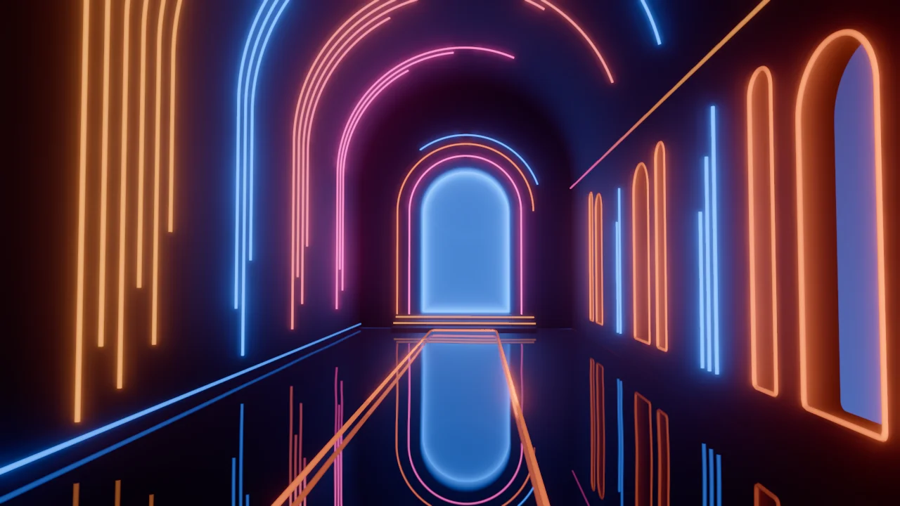
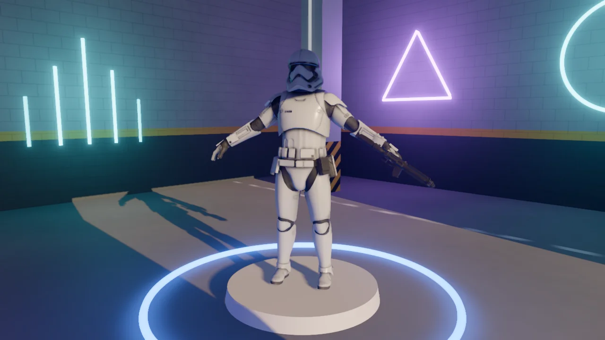
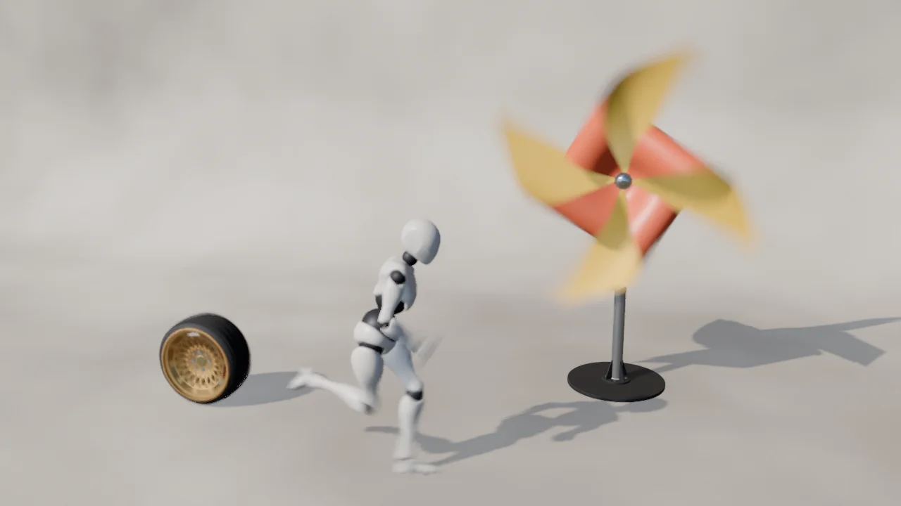
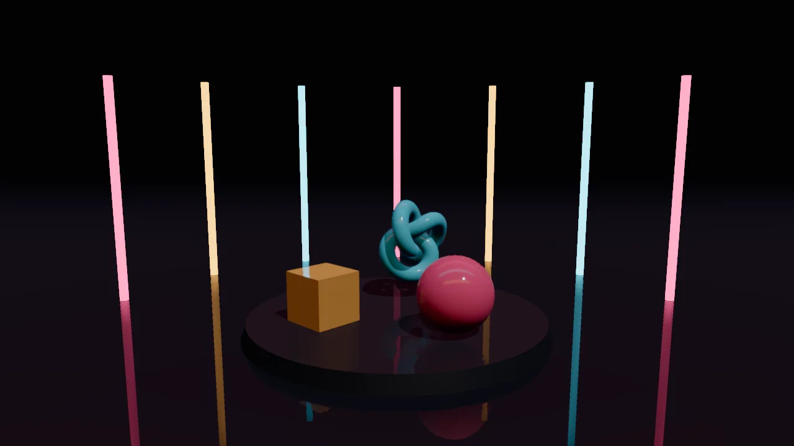
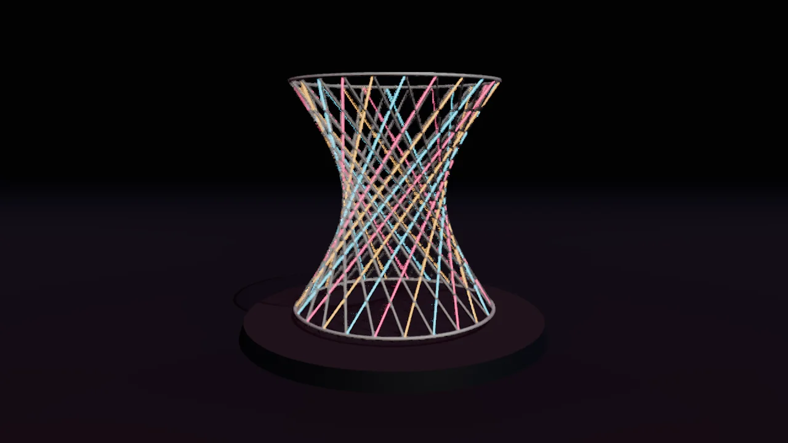
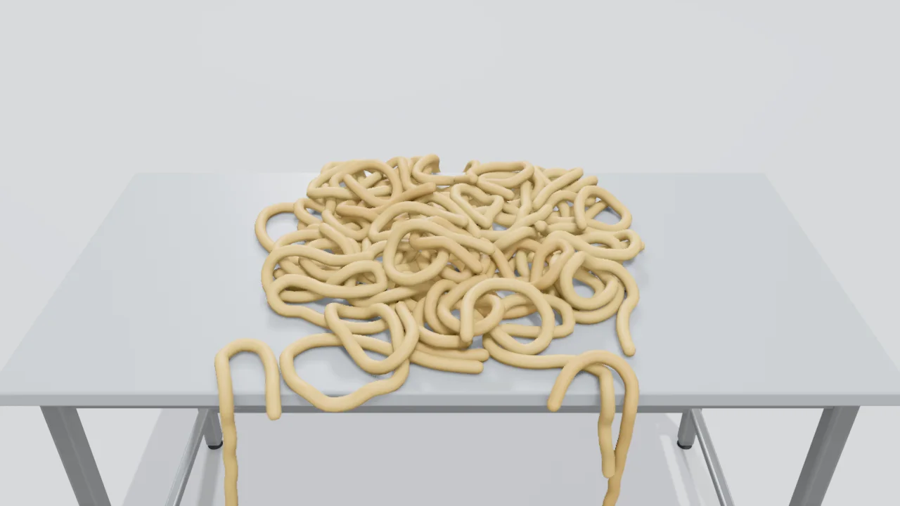
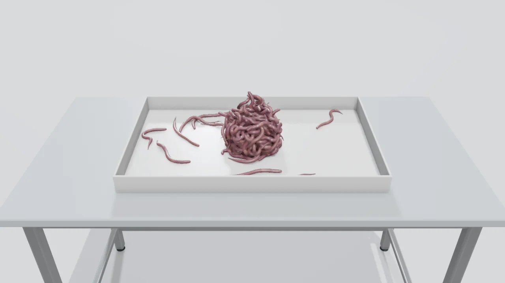
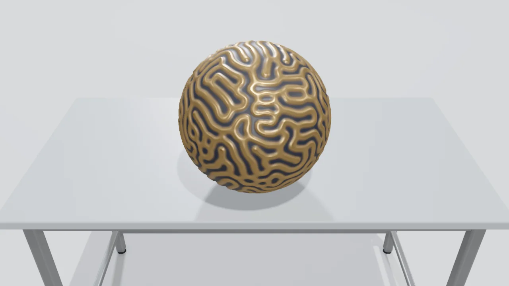

<h1 align="center"><a href="https://three-advanced-techniques.com/"></a></h1>

## Usage

```sh
npm install three three-advanced-techniques
```

You can import each technique or node like this:

```js
import { xeGTAO } from 'three-advanced-techniques'
```

And then use it with three.js' [WebGPURenderer](https://threejs.org/docs/#WebGPURenderer). The [docs](https://three-advanced-techniques.com/docs/) have each technique's usage and every module's reference, and each technique's README linked below has its usage too.

## Rendering

<table>
  <tr>
    <td align="center" width="50%"><a href="https://github.com/marcofugaro/three-advanced-techniques/tree/main/rendering/ambient-occlusion#ambient-occlusion"><br>Ambient Occlusion</a></td>
    <td align="center" width="50%"><a href="https://github.com/marcofugaro/three-advanced-techniques/tree/main/rendering/area-light#area-light"><br>Area Light</a></td>
  </tr>
  <tr>
    <td align="center" width="50%"><a href="https://github.com/marcofugaro/three-advanced-techniques/tree/main/rendering/bloom#bloom"><br>Bloom</a></td>
    <td align="center" width="50%"><a href="https://github.com/marcofugaro/three-advanced-techniques/tree/main/rendering/environment-lighting#environment-lighting"><br>Environment Lighting</a></td>
  </tr>
  <tr>
    <td align="center" width="50%"><a href="https://github.com/marcofugaro/three-advanced-techniques/tree/main/rendering/motion-blur#motion-blur"><br>Motion Blur</a></td>
    <td align="center" width="50%"><a href="https://github.com/marcofugaro/three-advanced-techniques/tree/main/rendering/precomputed-lighting#precomputed-lighting"><br>Precomputed Lighting</a></td>
  </tr>
  <tr>
    <td align="center" width="50%"><a href="https://github.com/marcofugaro/three-advanced-techniques/tree/main/rendering/screen-space-reflections#screen-space-reflections"><br>Screen-Space Reflections</a></td>
    <td align="center" width="50%"><a href="https://github.com/marcofugaro/three-advanced-techniques/tree/main/rendering/taau#taau"><br>TAAU</a></td>
  </tr>
</table>

## Simulations

<table>
  <tr>
    <td align="center" width="50%"><a href="https://github.com/marcofugaro/three-advanced-techniques/tree/main/simulations/noodles#noodles"><br>Noodles</a></td>
    <td align="center" width="50%"><a href="https://github.com/marcofugaro/three-advanced-techniques/tree/main/simulations/noodles#wormsimulation"><br>Worms</a></td>
  </tr>
  <tr>
    <td align="center" width="50%"><a href="https://github.com/marcofugaro/three-advanced-techniques/tree/main/simulations/reaction-diffusion#reaction-diffusion"><br>Reaction Diffusion</a></td>
    <td width="50%"></td>
  </tr>
</table>
