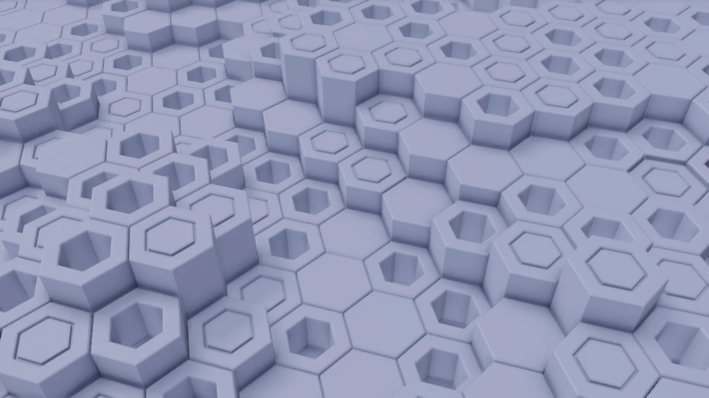

# Ambient occlusion

A fast version of GTAO. XeGTAO's ground-truth ambient occlusion, at half resolution, denoised and accumulated over frames. Creases, contact and the gaps between things darken; open surfaces stay clean, with no noise left on them. After Intel's [XeGTAO](https://github.com/GameTechDev/XeGTAO) and Jimenez et al., [_Practical Real-Time Strategies for Accurate Indirect Occlusion_](https://research.activision.com/publications/archives/practical-real-time-strategies-for-accurate-indirect-occlusion) (2016), accumulated as in Schied et al., [_Spatiotemporal Variance-Guided Filtering_](https://research.nvidia.com/publication/2017-07_spatiotemporal-variance-guided-filtering-real-time-reconstruction-path-traced) (2017).

<a href="https://marcofugaro.github.io/three-advanced-techniques/rendering/ambient-occlusion/"></a>

#### Live link: https://marcofugaro.github.io/three-advanced-techniques/rendering/ambient-occlusion/

## Usage

The occlusion runs on an opaque prepass's depth, and the scene's materials take it as their ambient occlusion: it darkens the ambient light only, not the direct light.

```js
import { RenderPipeline } from 'three/webgpu'
import { builtinAOContext, context, pass } from 'three/tsl'
import { xeGTAO } from 'three-advanced-techniques'

const prePass = pass(scene, camera, { samples: 0 })
prePass.transparent = false
prePass.contextNode = context({ getAO: null }) // the prepass mustn't read the occlusion it feeds

const occlusion = xeGTAO(prePass.getTextureNode('depth'), camera, { radius: 0.5 }) // world units

const scenePass = pass(scene, camera)
scenePass.contextNode = builtinAOContext(occlusion.getMaterialAONode())

const renderPipeline = new RenderPipeline(renderer)
renderPipeline.outputNode = scenePass
```

Or, as a post effect on the scene pass's own depth, multiply its color by `occlusion.getAONode()`. That form can also take the scene pass's motion vectors as `velocityNode`, so what moves on its own reprojects along them. A `normalNode`, the view normal from the prepass, replaces the normals rebuilt from depth.

## Why it's fast

Ambient occlusion reads the depth buffer many times per pixel, and cleaning up its noise reads the result many times again. This one keeps both cheap.

- **Half resolution, depth read once.** It runs at half resolution, on a small copy of the depth made once per frame.
- **Few samples, no leftover noise.** Each pixel searches only 2 directions, 3 steps each way, in a 4×4 pattern that a matching 4×4 blur averages back into a clean result.
- **Two jobs in one pass.** The blur and the blending with previous frames happen in the same pass.
- **No full-size AO texture.** The final upscale runs inside your materials' shader, and the background skips the search.

## What it improves

- **A moving tile.** The 4×4 tile moves every frame, so the taps land at new distances, and the history averages them.
- **Moved occluders.** Where an occluder moves in or out of the kernel's footprint, the history shortens, with or without motion vectors.
- **Scale-free tolerances.** Every depth test is a share of the view distance.
- **Ambient light only.** `getMaterialAONode()` runs the upsample in each material's own fragment, so the occlusion scales the ambient light and leaves the direct light alone.
