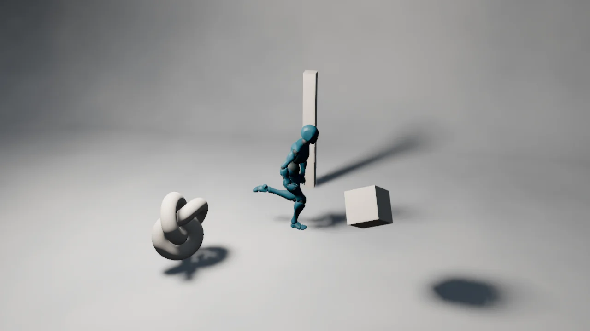

# Area light

Accurate soft shadows for three.js's `RectAreaLight`, ray-marched in screen space toward the light's whole area. Each pixel marches a fitted shadow map toward a few points on the emitter, after Xie, Tabellion and Pearce, [_Soft Shadows by Ray Tracing Multilayer Transparent Shadow Maps_](https://doi.org/10.2312/EGWR/EGSR07/265-276) (2007), and the frames accumulate and filter in the order of Schied et al., [_Spatiotemporal Variance-Guided Filtering_](https://research.nvidia.com/publication/2017-07_spatiotemporal-variance-guided-filtering-real-time-reconstruction-path-traced) (2017). With it, `rectAreaLTC` gives three's rect-light shading, after Heitz et al., [_Real-Time Polygonal-Light Shading with Linearly Transformed Cosines_](https://eheitzresearch.wordpress.com/415-2/) (2016), as TSL helpers for custom lighting models.

<a href="https://three-advanced-techniques.com/rendering/area-light/"></a>

#### Live link: https://three-advanced-techniques.com/rendering/area-light/

## Usage

```sh
npm install three three-advanced-techniques
```

```js
import * as THREE from 'three/webgpu'
import { RectAreaLightShadow } from 'three-advanced-techniques' // also gives three's RectAreaLight its LTC tables

const light = new THREE.RectAreaLight('#fff0dc', 30, 1.2, 0.7) // a softbox overhead
light.position.set(0, 3.5, 0)
light.lookAt(0.3, 0, 0.3)
scene.add(light)
character.traverse((child) => (child.castShadow = true)) // receivers need a MeshStandardNodeMaterial or MeshPhysicalNodeMaterial

const shadow = new RectAreaLightShadow(light, {
  rayLength: 6, // metres the march reaches toward the light, 5 by default
})
await shadow.compileAsync(renderer, scene, camera)

renderer.setAnimationLoop(() => {
  mixer.update(delta) // every pose and transform first
  shadow.render(renderer, scene, camera) // then the mask, before the beauty
  renderer.render(scene, camera) // or renderPipeline.render()
})
```

The shadow takes over `light.colorNode`, multiplying the light by a screen-space mask, so it follows the light's `color`, `intensity`, `width` and `height` as they change. Call `render()` once a frame, outside any `RenderPipeline`; one shadow serves one light. `getDebugNode('mask')` shows the mask full-screen, and `RectAreaLightShadowHelper` draws the caster boxes and the fitted shadow camera.

For a lighting model of your own, `rectAreaLTC` splits three's rect-light maths into per-pixel and per-light helpers (`ltcBasis`, `ltcLobe`, `rectAreaCorners`, `rectAreaDiffuseFormFactor`, `ltcFormFactor`, ...), inlined with no WGSL functions, so several lights share one lobe lookup. `horizonClip(builder, 'tabulated')` adds Heitz's tabulated horizon clip, which is more accurate than three's analytic one near the horizon. In `directRectArea()`, the `lightColor` it hands you already carries the shadow.

## Why it's fast

Soft shadows from an area light usually take many rays per pixel, or many shadow maps. This one takes a few per pixel per frame, and only where they can hit something.

- **Rays only where casters are.** Each ray is clipped to the boxes of the casters it crosses, so a floor pixel beside a character marches that character's box alone, in short steps. Skinned characters are boxed by one box per bone, not by skinning their vertices on the CPU.
- **A shadow map fitted to the casters.** The shadow camera wraps the casters every frame, so its texels go where the shadows are.
- **Half resolution.** The march, its history and its blur run at half the screen's resolution, and the light reads the mask through a depth-aware upsample in its own shader: no extra full-screen pass.
- **Few samples, many frames.** 4 points on the light and 10 steps per pixel per frame; the points move along a low-discrepancy sequence every frame and the history adds up to 16 frames.
- **One projection per ray.** Each ray is projected into the shadow map once and interpolated there, not transformed at every step.

## What it improves

- **No smearing behind moving casters.** The history is shortened only where a moving caster's rays pass, by how fast it moves, so a running character's shadow keeps up while the still parts of the frame stay converged.
- **Its own motion vectors.** It reprojects each surface by its own motion, skinning and instancing included, without touching three's `velocity`, so motion blur and TAAU keep theirs.
