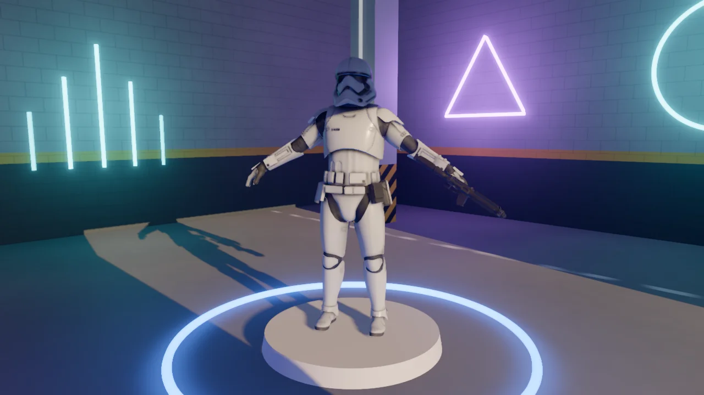

# Environment lighting

Image-based lighting that keeps up with a changing scene. For the specular, `SlicedPMREMGenerator` regenerates a scene's PMREM a few cube faces or mip levels a frame. For the diffuse, `IrradianceProbeColumn` captures order-2 spherical-harmonic probes at a few heights on a vertical axis, projects them on the GPU and blends them by height. After Ramamoorthi and Hanrahan, [_An Efficient Representation for Irradiance Environment Maps_](https://graphics.stanford.edu/papers/envmap/) (2001), Sloan, [_Stupid Spherical Harmonics (SH) Tricks_](https://www.ppsloan.org/publications/StupidSH36.pdf) (2008), and Driscoll, [_Cubemap Texel Solid Angle_](https://www.rorydriscoll.com/2012/01/15/cubemap-texel-solid-angle/) (2012).

<a href="https://three-advanced-techniques.com/rendering/environment-lighting/"></a>

#### Live link: https://three-advanced-techniques.com/rendering/environment-lighting/

## Usage

```sh
npm install three three-advanced-techniques
```

```js
import * as THREE from 'three/webgpu'
import { IrradianceProbeColumn, SlicedPMREMGenerator } from 'three-advanced-techniques'

// Captured from inside the object, without it
object.visible = false

// The specular: the scene's PMREM
const generator = new SlicedPMREMGenerator(renderer) // samples: 32 for a faster prefilter, null for three's
const capture = { near: 0.05, far: 20, size: 256, position: new THREE.Vector3(0, 1, 0) }
const pmrem = generator.fromScene(scene, 0, capture.near, capture.far, capture)
material.envMap = pmrem.texture

// The diffuse: probes on the object's vertical axis, at heights along the column's +y
const probes = new IrradianceProbeColumn([0.3, 1, 1.7], { near: capture.near, far: capture.far })
probes.update(renderer, scene)
material.contextNode = probes.irradianceContext

object.visible = true

// While the scene changes: one slice a frame, then a swap the materials don't notice
let job = null
renderer.setAnimationLoop(() => {
  renderer.render(scene, camera)
  object.visible = false
  job ??= generator.fromSceneSliced(scene, { ...capture, facesPerSlice: 2 })
  if (job.step()) {
    job.copyTo(pmrem) // texel for texel, into the texture the materials read
    probes.update(renderer, scene) // or sliced too: probes.capture(renderer, scene, i, { faces: [0, 3] }), then probes.project(renderer)
    job = null
  }
  object.visible = true
})
```

The column is an `Object3D`: move it onto the object's axis, and an object turning about that axis keeps the same probes. `irradianceContext` changes standard and physical materials lit by an environment (`envMap`, `envNode` or `scene.environment`) on the WebGPU backend. `IrradianceProbeColumnHelper` shows each probe as a sphere lit by it alone.

## Why it's fast

Regenerating an environment means rendering the scene six times and prefiltering the result, which is a hitch when it lands in one frame. These spread it out and keep it on the GPU.

- **No hitch.** A PMREM is 6 face renders and a prefilter pass per mip level; the job runs a few of them a frame into a back target.
- **A prefilter in one pass.** three's prefilter renders each face of each mip level in a pass of its own, 36 at 256², with 256 GGX samples a texel on the sharp levels, and those passes cost more than the sampling. `SlicedPMREMGenerator` renders every level into one atlas in one pass, with 64 filtered importance samples a texel on level 1, doubling each level, and copies the atlas into the PMREM in one command buffer: 0.43 ms against 4.47 on a Mac mini, with an error against a 4096-sample reference a little above three's.
- **No rebinding.** The finished PMREM is copied into the live texture level by level, so materials keep their texture and nothing recompiles.
- **Projected on the GPU.** Compute passes reduce each probe's cube to its 9 coefficients, which stay in a storage buffer the fragments read: no readback, no frame of latency.
- **Small captures.** 9 coefficients keep only the low frequencies, so a 64×64 cube per probe is plenty; the demo takes 128×128 so its thin neon tubes don't fall between texels.
- **Cheap to shade.** A fragment blends two probes' 9 coefficients in a few dozen multiply-adds, or a vertex does it with `perVertex`.

## What it improves

- **Diffuse that changes with height.** A PMREM is seen from one point; the probes see the floor's bounce at the feet and the ceiling's light at the head.
- **The right lobe.** The PMREM's roughest level is broader than the cosine lobe the diffuse needs, which flattens the shading; 9 SH coefficients give the cosine-weighted irradiance to within a few percent. `windowing` damps the ringing of small bright lights.
