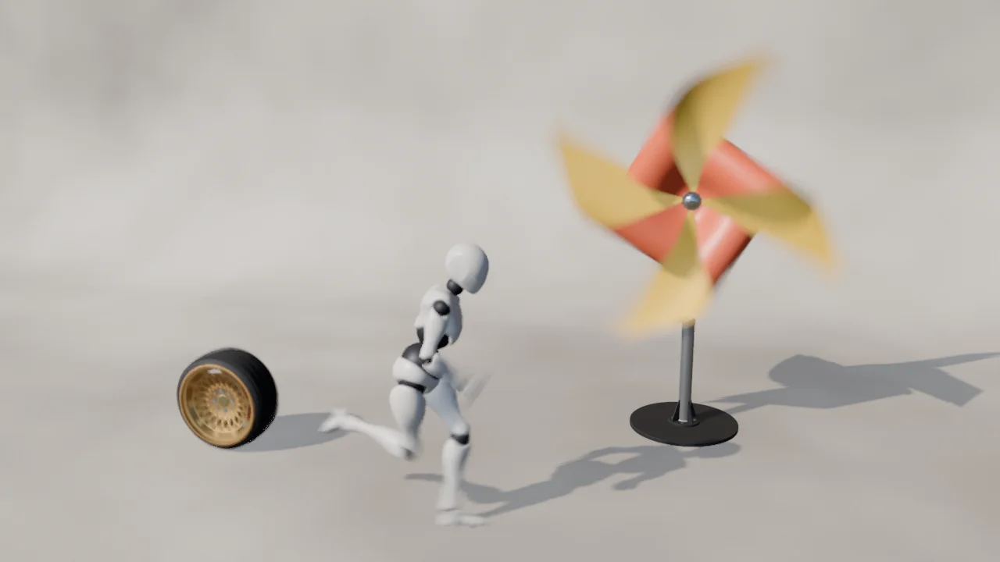

# Motion blur

Object and camera motion blur as a tile-based reconstruction filter, after McGuire et al., [_A Reconstruction Filter for Plausible Motion Blur_](https://dblp.uni-trier.de/rec/conf/si3d/McGuireHBO12.html) (2012), Guertin et al., [_A Fast and Stable Feature-Aware Motion Blur Filter_](https://doi.org/10.2312/hpg.20141093) (2014), Jimenez, [_Next Generation Post Processing in Call of Duty: Advanced Warfare_](https://www.iryoku.com/next-generation-post-processing-in-call-of-duty-advanced-warfare/) (2014).

<a href="https://marcofugaro.github.io/three-advanced-techniques/rendering/motion-blur/"></a>

[Live](https://marcofugaro.github.io/three-advanced-techniques/rendering/motion-blur/)

## Usage

```js
import { HalfFloatType, RenderPipeline, RGFormat } from 'three/webgpu'
import { mrt, output, pass, velocity } from 'three/tsl'
import { motionBlur } from 'three-advanced-techniques'

const scenePass = pass(scene, camera)
scenePass.setMRT(mrt({ output, velocity }))
const velocityTexture = scenePass.getTexture('velocity')
velocityTexture.type = HalfFloatType // RG16F
velocityTexture.format = RGFormat

const blurred = motionBlur(scenePass.getTextureNode('output'), scenePass.getTextureNode('depth'), camera, {
  velocityNode: scenePass.getTextureNode('velocity'), // omit for camera motion only, without the MRT
  shutterAngle: 180,
})

const renderPipeline = new RenderPipeline(renderer)
renderPipeline.outputNode = blurred
```

## Why it's fast

A simple motion blur takes 16 samples along every pixel's motion, even where nothing moves. This one spends samples only where there's motion to show.

- **Still areas are free.** A quick compute pass finds the largest motion in each 32×32-pixel tile; pixels with no motion nearby are left as they are.
- **Uniform motion gets a cheap blur.** Where everything moves together a plain blur is enough; only the edges between different motions pay for the full depth-aware one.
- **Samples scale with the streak.** One sample every 2 pixels, up to 16, so short streaks are cheap.
- **Small inputs, no extra pass.** Velocity and depth are packed into a quarter-size texture, and the blur runs inside the pass that uses it.
- **Camera-only motion needs no velocity buffer.** Camera motion is worked out from depth.

## What it improves

- **Streaks past the outline.** Each pixel gathers along its neighbourhood's largest velocity, so a moving object's streak reaches past its silhouette.
- **Depth-aware taps.** Taps are weighted by depth, and the background uncovered behind a streak is filled from the pixel's own blurred background.
- **Mirrored, jittered taps.** Taps come in mirrored pairs on a jittered lattice instead of evenly spaced copies.
- **Exposure from a shutter angle.** The streak covers `shutterAngle` / 360 of a smoothed frame time, capped by `maxBlurRadius`, so a hitch frame keeps a normal-length streak. A camera turn past `cutRotation` drops the camera blur for that frame, and a gap past `maxFrameGap` drops all of it.
- **The sky blurs.** Background pixels blur with the camera's rotation.
