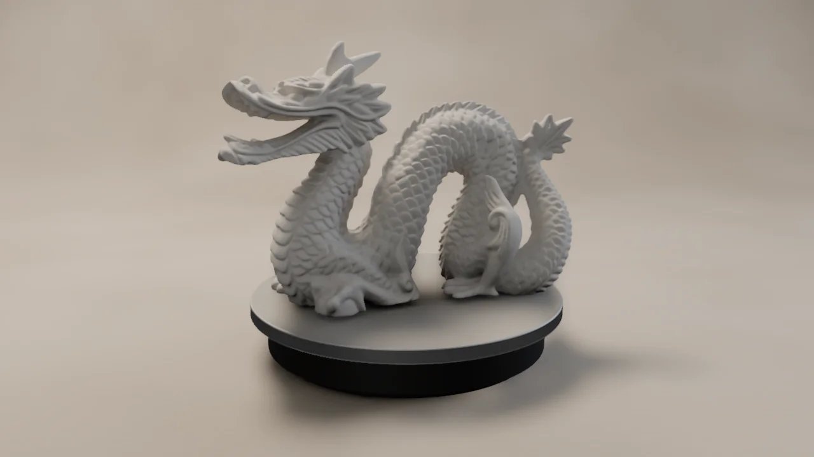

# Precomputed lighting

Self-shadows, bounce light and soft contact shadows for a rigid mesh, precomputed once and shaded live as the mesh turns and the lights move. `SelfShadowVisibilityMasks` stores, per vertex, the directions that escape the mesh as a bit mask; `SelfShadowRadianceTransfer` stores them as 16 spherical-harmonic coefficients, for softer shadows. `PrecomputedRadiosity` adds the light the mesh bounces onto itself, as Enlighten does. `PrecomputedAmbientOcclusion` bakes ambient occlusion and a rect light's soft shadow onto static surfaces, and `ContactOcclusion` darkens the floor under objects as they move. After Sloan et al., [_Precomputed Radiance Transfer_](https://doi.org/10.1145/566654.566612) (2002), Hanrahan et al., [_A Rapid Hierarchical Radiosity Algorithm_](https://doi.org/10.1145/122718.122740) (1991), Martin and Einarsson, [_A Real-Time Radiosity Architecture for Video Games_](https://advances.realtimerendering.com/s2010/index.html) (2010), and Heitz et al., [_Combining Analytic Direct Illumination and Stochastic Shadows_](https://research.nvidia.com/publication/2018-05_combining-analytic-direct-illumination-and-stochastic-shadows) (2018).

<a href="https://three-advanced-techniques.com/rendering/precomputed-lighting/"></a>

#### Live link: https://three-advanced-techniques.com/rendering/precomputed-lighting/

## Usage

Make sure to install [`three-mesh-bvh`](https://github.com/gkjohnson/three-mesh-bvh) as well, needed by every class here to build the BVH their bakes trace rays against:

```sh
npm install three three-mesh-bvh three-advanced-techniques
```

### SelfShadowVisibilityMasks

```js
import * as THREE from 'three/webgpu'
import { attribute } from 'three/tsl'
import { SelfShadowVisibilityMasks } from 'three-advanced-techniques'

// The mesh's geometry needs an index and normals; up to four lights of any kind
const masks = new SelfShadowVisibilityMasks(mesh, [keyLight, rimLight, sun, sky], { softness: 0.01 }) // σ in mesh units
await masks.bake(renderer, { resolution: 64 }) // kept as masks.data, plain typed arrays: cache them
// Optional: while a light moves in the mesh's frame, spread by one gather over pairs of vertices instead of the
// explicit steps; built in workers for that σ alone, structured-cloneable to cache
masks.motionKernel = await masks.diffusion.createKernel(masks.softness, { clusterSize: 2, mass: 0.99 })
await masks.compileAsync(renderer) // optional: every pipeline update() may build, ahead
mesh.geometry.setAttribute('visibility', masks.visibility) // per vertex: light 0's visibility in x, light 1's in y, …

// Each direct light's contribution × its visibility: the rect lights', and the directional, point and spot lights'
const selfShadow = attribute('visibility', 'vec4')
const visibleFrom = (light) => selfShadow[{ [keyLight.id]: 'x', [rimLight.id]: 'y', [sun.id]: 'z' }[light.id]].saturate()
class MaskedLighting extends THREE.PhysicalLightingModel {
  directRectArea(input, builder) {
    super.directRectArea({ ...input, lightColor: input.lightColor.mul(visibleFrom(input.lightNode.light)) }, builder)
  }
  direct(input, builder) {
    super.direct({ ...input, lightColor: input.lightColor.mul(visibleFrom(input.lightNode.light)) }, builder)
  }
}
mesh.material.setupLightingModel = () => new MaskedLighting()
// An ambient or hemisphere light's or a probe's visibility is the occlusion of that sky: it scales the indirect light
mesh.material.aoNode = selfShadow.w.saturate()

renderer.setAnimationLoop(() => {
  masks.update(renderer) // evaluates only the lights that moved in the mesh's frame
  renderer.render(scene, camera)
})
```

### SelfShadowRadianceTransfer

```js
import { SelfShadowRadianceTransfer } from 'three-advanced-techniques'

// The same self-shadow in order-4 spherical harmonics, with the same API: softer, with no crisp shadow
const transfer = new SelfShadowRadianceTransfer(mesh, [keyLight, rimLight, sun, sky])
await transfer.bake({ rays: 256 }) // in workers, kept as transfer.data: cache it
// Per vertex, light 0's ratio in x, light 1's in y, …: shade it as the masks' visibility, saturated
mesh.geometry.setAttribute('visibility', transfer.visibility)

renderer.setAnimationLoop(() => {
  transfer.update(renderer) // writes only when a light moved in the mesh's frame or a setting changed
  renderer.render(scene, camera)
})
```

### PrecomputedRadiosity

```js
import { diffuseColor } from 'three/tsl'
import { PrecomputedRadiosity } from 'three-advanced-techniques'

// The light the mesh bounces onto itself, from any of three's lights, unoccluded
const radiosity = new PrecomputedRadiosity(mesh, { lights: [keyLight], albedo: 0xe9e3d9, bounces: 2 })
await radiosity.bake({ rays: 128, patches: 2048 }) // in workers; resolves to a transfer to cache
mesh.material.emissiveNode = diffuseColor.rgb.mul(radiosity.irradianceNode).div(Math.PI)

renderer.setAnimationLoop(() => {
  radiosity.update(renderer) // recomputes only when an input changed
  renderer.render(scene, camera)
})
```

To bounce only the direct light a self-shadow leaves, compose `lightIrradiance()` with its visibility:

```js
import { storage } from 'three/tsl'

const visibility = storage(masks.visibility, 'vec4', masks.count).toReadOnly()
radiosity.irradiance = (position, normal, index) =>
  radiosity.lightIrradiance(keyLight)(position, normal).mul(visibility.element(index).x)

renderer.setAnimationLoop(() => {
  if (masks.update(renderer)) radiosity.needsUpdate = true // new visibility: the bounce reads it
  radiosity.update(renderer)
  renderer.render(scene, camera)
})
```

### PrecomputedAmbientOcclusion

```js
import * as THREE from 'three/webgpu'
import { attribute } from 'three/tsl'
import { PrecomputedAmbientOcclusion } from 'three-advanced-techniques'

// Ray traced against the occluders where they stand now, at static receivers: one per vertex of a BufferGeometry with
// world-space positions and normals
const baker = new PrecomputedAmbientOcclusion(mesh)
const receivers = pedestal.geometry.clone().applyMatrix4(pedestal.matrixWorld)
const occlusion = await baker.bakeOcclusion(receivers, { rays: 64, maxDistance: 0.5 }) // Float32Array, 0 … 1
pedestal.geometry.setAttribute('occlusion', new THREE.BufferAttribute(occlusion, 1))
pedestal.material.aoNode = attribute('occlusion', 'float')

// A light's soft shadow there: the share of it each receiver sees, 0 … 1, to multiply that light by
const shadow = await baker.bakeVisibility(keyLight, receivers, { samples: 8 })
```

### ContactOcclusion

UUnlike the classic `ContactShadow`, which render the objects' silhouette from below and blur it every frame, `ContactOcclusion` ray traces the floor's ambient occlusion once, so a frame costs one texture read, but it holds only while the objects keep their pose in the frame.

```js
import { ContactOcclusion, PrecomputedAmbientOcclusion } from 'three-advanced-techniques'

// The contact occlusion on the floor about the objects, in a texture in the turntable's frame, so it turns with it
const contact = new ContactOcclusion(turntable, { size: 2.4, resolution: 128, height: 0.001 })
floor.material.aoNode = contact.aoNode
// Traced by a baker of the occluders, captured with the turntable at identity
const baker = new PrecomputedAmbientOcclusion(mesh)
await contact.bake(baker, { rays: 128, maxDistance: 0.6 })
```

The masks, the radiance transfer and the radiosity's transfer depend on the geometry alone, so they hold for any pose of the mesh and of the lights.

## Why it's fast

Ray tracing is done once, ahead; each frame only reads what it found, and only when something moved.

- **Bits, not rays.** A vertex's mask holds a bit per direction of its hemisphere. Shading a light reads the mask at 64 points over the rect instead of tracing 64 rays, and a block of the mask that is all open or all closed is stored as a two-bit code.
- **Nothing to do when still.** The masks re-evaluate a light only when it moves in the mesh's frame, and the bounce recomputes only when its inputs change: a still frame costs a comparison.
- **Cheaper in motion.** While a light moves, the masks read fewer points and each one's nearest bit; once still they refine to the full estimate. A clustered motion kernel (`masks.diffusion.createKernel(σ, { clusterSize: 2 })`) spreads them in one gather instead of ⌈σ²·maxRate⌉ explicit steps.
- **Sixteen numbers, not a mask.** `SelfShadowRadianceTransfer` projects each light onto a vertex's 16 coefficients in one compute and divides by the unshadowed response in closed form; the band limit is its smoothing, so it has no spread to run, and no crisp shadow either.

