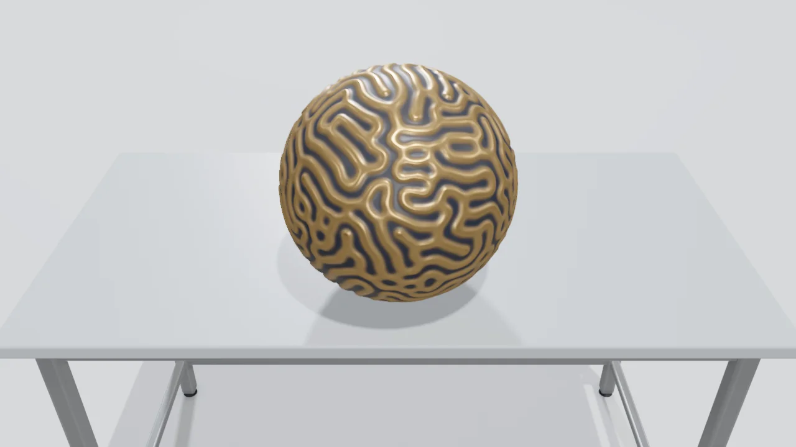

# Reaction diffusion

Compute shader reaction-diffusion in TSL. `ReactionDiffusionSimulation2D` grows Gray-Scott patterns over the surface of any triangle mesh and draws that mesh raised where the pattern grows, with any material. After Turk, [_Generating Textures on Arbitrary Surfaces Using Reaction-Diffusion_](https://doi.org/10.1145/127719.122749) (1991), Pearson, [_Complex Patterns in a Simple System_](https://arxiv.org/abs/patt-sol/9304003) (1993), and Sims, [_Reaction-Diffusion Tutorial_](https://www.karlsims.com/rd.html).

<a href="https://marcofugaro.github.io/three-advanced-techniques/simulations/reaction-diffusion/"></a>

#### Live link: https://marcofugaro.github.io/three-advanced-techniques/simulations/reaction-diffusion/

## Usage

```sh
npm install three three-advanced-techniques
```

```js
import * as THREE from 'three/webgpu'
import { color, mix } from 'three/tsl'
import { ReactionDiffusionSimulation2D } from 'three-advanced-techniques'

// The pattern is a few edges wide: a finer mesh grows a finer pattern.
const geometry = new THREE.IcosahedronGeometry(1, 63)
const reactionDiffusion = new ReactionDiffusionSimulation2D(geometry, new THREE.MeshStandardNodeMaterial(), {
  feedRate: 0.0545, // coral
  killRate: 0.062,
  displacementAmplitude: 0.02, // how far the ridges rise
})
// 0 in the grooves, 1 on the ridges
reactionDiffusion.material.colorNode = mix(color('#1d2230'), color('#e0b25a'), reactionDiffusion.smoothPatternNode)
scene.add(reactionDiffusion)
await reactionDiffusion.compileAsync(renderer)

const timer = new THREE.Timer()
renderer.setAnimationLoop((time) => {
  timer.update(time)
  reactionDiffusion.brush = raycaster.intersectObject(reactionDiffusion)[0]?.point ?? null // while dragging: a point or a THREE.Line3, world space
  reactionDiffusion.update(renderer, timer.getDelta())
  renderer.render(scene, camera)
})
```

`reset()` starts over from scattered seeds, and `clear()` empties the surface for the brush to seed (`brushMode = 'seed'`) or carve (`'erase'`). Every option is a live property: `rd.feedRate = 0.0367` and `rd.killRate = 0.0649` turn the coral into dividing spots.

## How it works

- **Any mesh.** The two chemicals live on the vertices, welded by position, so the pattern flows across UV and hard-normal seams. Each vertex diffuses toward the mean of its neighbours, so lengths are counted in edges: an even mesh, such as an icosphere or a remesh, grows an even pattern.
- **Relief.** The pattern raises the surface along its normals, and the normals tilt with the pattern's slope, so any material shades the relief, shadows included. `smoothPatternNode` bends the pattern's contours across each triangle, smooth on a coarse mesh.
- **Brush.** A point or a `THREE.Line3` stroke, in world space, seeds or erases the vertices within `brushRadius` on every update while it's set. Below 1, `brushStrength` blends toward that instead, so a stroke can fade out.

## Why it's fast

- **Only what changes is simulated.** Vertices are stepped in blocks of 64 nearby ones. A block sleeps while neither it nor a block next to it changed, as ahead of a growth front; with a small `sleepThreshold`, such as `1e-6`, a pattern that has nearly settled sleeps too. The GPU lists the awake blocks and dispatches only those, nothing read back.
- **Neighbours from workgroup memory.** Each block loads its vertices and the ring around them into workgroup memory once, and every vertex reads its neighbours from there, their indices packed 8 or 16 bits each.
- **One dispatch list a frame.** A frame's steps, the brush and the surface refresh go out in one `renderer.compute()`, ping-ponging between two buffers.
- **A cheap draw.** The pattern and its slope are computed once per vertex per frame, only where it changed; the vertex shader reads them, displaces and tilts the normal, with no normals recomputed.
